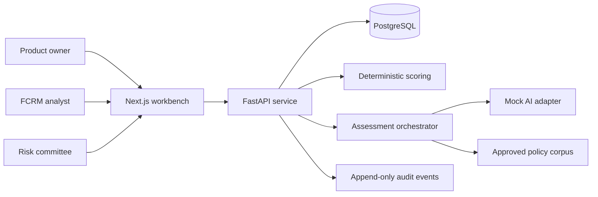

# Architecture Overview

The workflow engine and scoring service are deterministic. The AI adapter may propose extracted facts, retrieval-backed rationale and gaps, but cannot mutate approved configuration, advance gated workflow states, or make committee decisions.